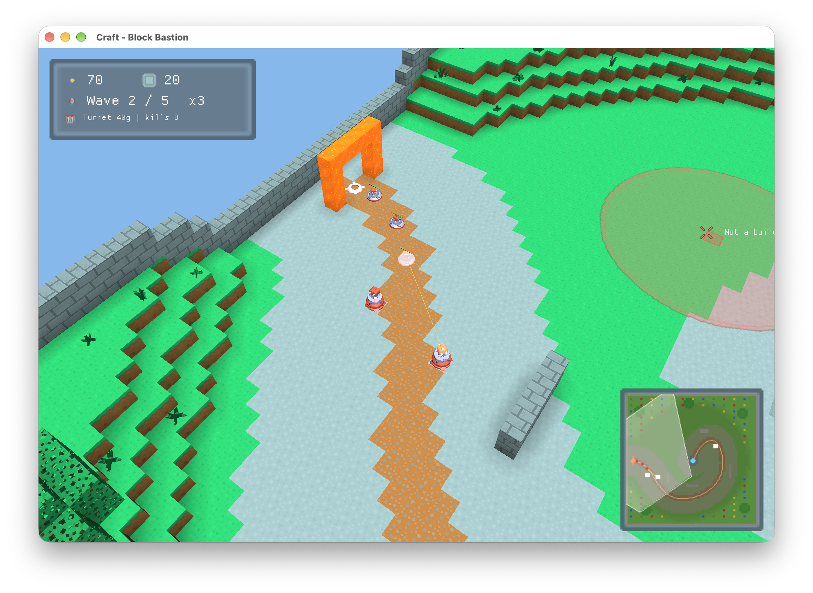
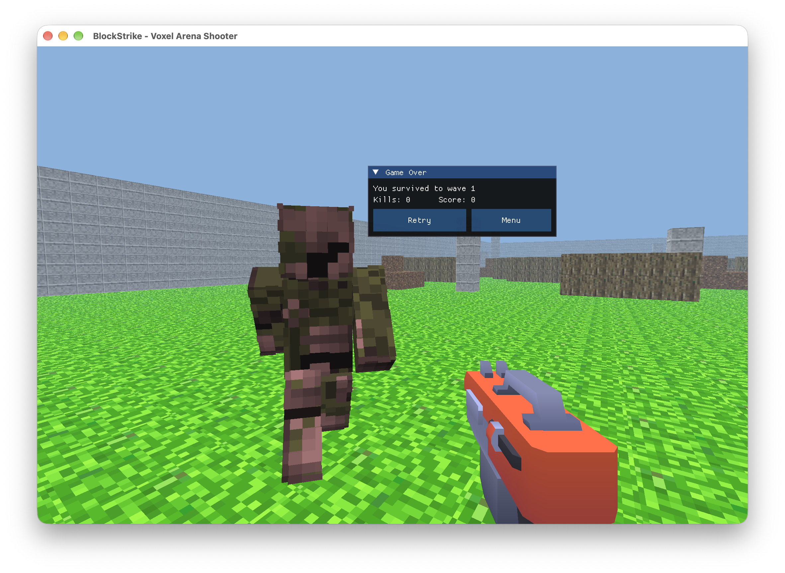
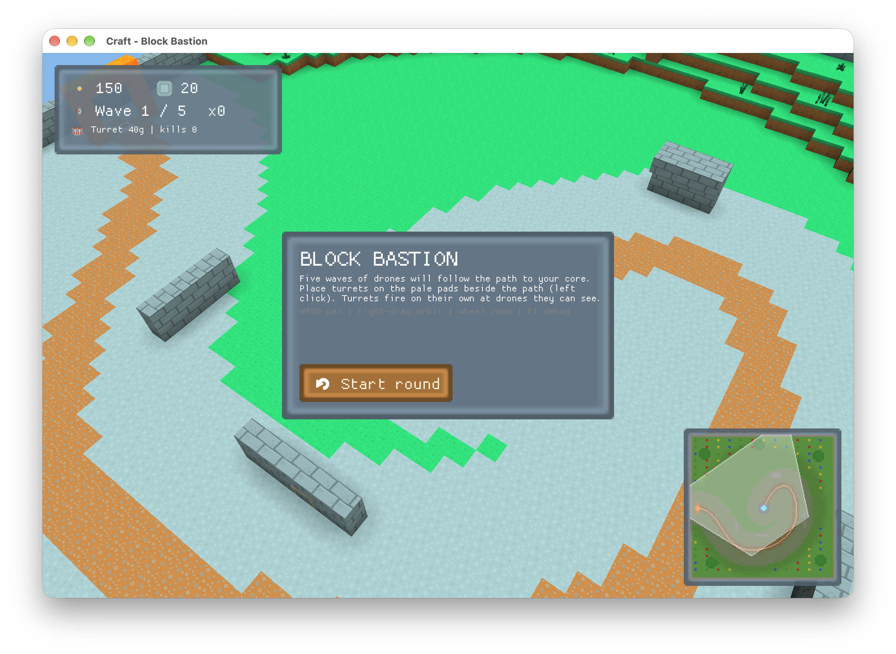

# COMP3421/COMP9415 Group Assignment — Voxel-based Game <!-- omit from toc -->

- **Term:** 2026 Term 3
- **Group size:** 2–3 students
- **Marks:** 100
- **Weighting:** 30%
- **Expected workload:** 25–30 hours per person
- **Submission platform:** GitLab

## Important Dates <!-- omit from toc -->

| Milestone | Timing |
|---|---|
| **Project starts and team formation** | Week 6 |
| **Project plan discussion** | Week 7 |
| **Revised plan submission due** | 23:59, 1 November 2026 (Week 7)|
| **Group project submission due** | 23:59, 15 November 2026 (Week 9)|
| **Presentation** | Week 10 lab sessions |

## Group Preferences Form ##
Please submit your group preferences information here through a Microsoft Form:
https://forms.cloud.microsoft/r/zixpregFC5

## Mouse Input Issue on WSL/VLab or other RDP <!-- omit from toc -->

Based on feedback from students in the individual assignmentand, and following investigation from our staffs, we found that on WSL/VLab or most of remote develop environments, there are mouse input issues, which can affect camera control and gameplay. We provide a document that explains the issue and provides some workarounds: [Mouse Input Issues and Workarounds on WSL/VLab or other RDP](mouse-input-rdp.md).

## Table of Contents <!-- omit from toc -->
- [1. Overview](#1-overview)
- [2. Starter Code](#2-starter-code)
- [3. Tasks](#3-tasks)
  - [3.1 Project Plan Discussion and Revised Plan (5 marks)](#31-project-plan-discussion-and-revised-plan-5-marks)
  - [3.2 Core Task: A Playable Voxel Game (50 marks)](#32-core-task-a-playable-voxel-game-50-marks)
  - [3.3 Challenge Tasks (up to 30 marks)](#33-challenge-tasks-up-to-30-marks)
- [4. Report and Evidence](#4-report-and-evidence)
  - [4.1 Performance and Benchmark Results](#41-performance-and-benchmark-results)
- [5. Submission and Presentation](#5-submission-and-presentation)
  - [5.1 Project Plan Discussion and Submission](#51-project-plan-discussion-and-submission)
  - [5.2 GitLab Submission](#52-gitlab-submission)
  - [5.3 Week 10 Live Presentation](#53-week-10-live-presentation)
- [6. External Code, Libraries, and Assets](#6-external-code-libraries-and-assets)
- [7. Marking Rubrics](#7-marking-rubrics)
  - [7.1 Core: Game Development (50 marks)](#71-core-game-development-50-marks)
  - [7.2 Challenge Tasks (up to 30 marks)](#72-challenge-tasks-up-to-30-marks)
  - [7.3 Report and Presentation (15 marks)](#73-report-and-presentation-15-marks)
  - [7.4 Project Plan Discussion and Revised Plan (5 marks)](#74-project-plan-discussion-and-revised-plan-5-marks)
- [8. Special Consideration](#8-special-consideration)
- [9. Late Submissions](#9-late-submissions)
- [10. Academic Integrity and AI Use](#10-academic-integrity-and-ai-use)

## 1. Overview

Work in a group of **2–3 students** to design and implement a simple, playable **3D voxel game** using OpenGL 3.3 Core and GLSL. Please **find your group members within your lab class by the end of Week 6**, and start planning your project as early as possible to ensure its timely completion. To submit your group preferences, **Please use this Microsoft Form: https://forms.cloud.microsoft/r/zixpregFC5 **

Choose a game concept that your group can complete within the expected workload. Suitable examples include a shooting, collection, puzzle, tower defence, or obstacle-course game. Other creative concepts are welcome. Your game must have a clear objective, rules, meaningful interaction, player feedback, and a completion or failure condition. 

The scene must use a coherent voxel style built from blocks and be rendered using real 3D geometry and depth. Gameplay may take place mainly on a plane, with an isometric or top-down camera, as in the tower defence example below. The voxel world must be at least **32 × 32 × 32 cells**, matching the minimum world dimensions of the individual assignment; not every cell needs to contain a solid block. Design the scene to demonstrate the required graphics techniques and support a playable game.

The assignment focuses on:
- **3D voxel graphics:** a coherent scene with real 3D geometry, depth, and a suitable camera.
- **Graphics techniques:** texture mapping, lighting, materials, hierarchical modelling, animation, and rendering.
- **Game development:** a playable game with meaningful interaction and feedback.

The assignment does not focus on:
- **Recreation of existing games:** you may use an existing game as inspiration, but we do not expect you to recreate a full game, like Minecraft.
- **Commercial-scale game design:** keep the game small and achievable for 2–3 students. The focus is on applying graphics techniques within a complete, simple game. 
- **Ray tracing:** it is an optional challenge, not a requirement.
- **Visual complexity:** a large number of objects or high-resolution textures do not earn marks by themselves.

> [!TIP]  
> You may reuse your individual assignment camera, but choose a camera suited to your game concept. For example, a first-person camera may suit a shooting game, while an isometric or top-down camera may suit a tower defence game.

> [!NOTE]  
> The assignment is **not a continuation of the individual assignment**. You may reuse your individual assignment code, but you are not required to do so. You may also use the starter code provided for this assignment. You are free to design and implement your own game, scene, and graphics techniques.
> Anyone without a group by Wednesday, 21 October, will be paired or grouped together by the tutors of their class.

## 2. Starter Code

The starter code is similar to the individual assignment starter, with an added game start screen. You may reuse code written by your group members for their individual assignments. Identify reused code in the report.

- The starter uses OpenGL 3.3 Core, GLSL, GLFW, GLAD where required, GLM, `stb_image`, and Dear ImGui. It provides window and resize handling, shader loading, a start screen, text rendering helpers, and a benchmark panel.
- CMake with Make is the recommended build workflow. Other compatible CMake generators, e.g. Ninja, may be useful for you to save time during development, but the submission must build and run with CMake and Make on **VLAB**.
- Replace the example tetrahedron and its fixed transform with your game. The starter does not implement any game rules, voxel storage, camera behaviour, meshes, texture mapping, lighting, hierarchy, animation, optimisation or ray tracing. You must implement these yourself to satisfy the assignment requirements.
- The starter code provides a simple start screen with a title, instructions. You can directly replace the title text in `src/app/TitleScreen.cpp`, and background image in `assets/textures/title_background.png` with your own. Or, you may replace it with your own start screen, but you must provide a way to start the game from the starter screen. For details, see the starter code README file. 

The starter also includes optional tools:

- In `src`, CMake fetches and links **[FastNoise2](https://github.com/Auburn/FastNoise2)** through `FetchContent`. You may use it to generate noise for procedural and complex terrain, like hills or holes. Its use is optional and does not earn marks by itself; assessment considers how you use it to support your scene and implementation.
- CTest and Catch2 are available for optional self-checking. Automated tests are not a submission requirement and are not directly assessed.

## 3. Tasks

The assignment is marked out of **100**, with the following distribution. Each mark is one percentage point of the assignment total; the assignment contributes **30%** to the course mark.

| Assessment component | Marks |
|---|---:|
| Project plan discussion and revised plan | 5 |
| Core game development | 50 |
| Challenge tasks | Up to 30 |
| Report | 7 |
| Live presentation | 8 |
| **Total** | **100** |

See [Marking Rubrics](#7-marking-rubrics) for the assessment standards.

### 3.1 Project Plan Discussion and Revised Plan (5 marks)

Submit a draft **`ProjectPlan.pdf`** in the root of your group's repository before your Week 7 lab discussion, which could make it more easier for your tutors revise and provide your feedback. The plan must not exceed **one A4 page**. 

Discuss your proposed project with your tutor during the **Week 7 lab session**, then revise the plan using that feedback. Submit the revised `ProjectPlan.pdf` by **23:59 on 1 November 2026 (end of Week 7)**. The discussion is worth **3 marks** and the revised plan is worth **2 marks**. A group that submits a plan without attending the discussion can receive at most **2/5 marks**. 

> [!WARNING]
> It means **ATTENDING WEEK 7 LAB SESSION IS MANDATORY** for full marks.

> [!TIP]
> You can use the lab sessions to discuss your game concept with your group members and tutor and find related assets.   
> You may also use the lab sessions to discuss your work distribution and technical implementation with your group members and tutor, to make sure you can handle the workload and complete the project on time.    

Please include the following items in your project plan and discuss with your tutor:

1. **Game concept and gameplay:** the objective, rules, controls, core interaction loop, and proposed levels or configurations.
2. **Visual and technical design:** the 3D voxel style, camera, key objects, materials, animation, and planned graphics techniques.
3. **Responsibilities:** the names of your 2–3 group members and their planned contributions, including integration work.
4. **Three milestones:** milestones for: a minimum playable version, a complete version, and a polished final submission. Identify what will work at each milestone.

Use the plan to keep the project achievable within 25–30 hours per person. Optional extensions should not prevent completion of the core game.

### 3.2 Core Task: A Playable Voxel Game (50 marks)

Implement a playable voxel game that satisfies all the requirements below. These headings organise the requirements; they are **not separate marking components**. The core game is assessed across three dimensions: **requirements satisfaction (20 marks)**, **technical achievement (20 marks)**, and **visual quality, including animation (10 marks)**. See [Section 7.1](#71-core-game-development-50-marks).

#### Playable Game and State Management

- Define a clear objective, rules, controls, and a completion or failure condition. Provide visible feedback such as score, progress, remaining time, health, or a completion message, as appropriate to your game.
- Make keyboard and/or mouse input affect gameplay, as you learned from Week 3-5 tutorials. Camera navigation, debug controls, and static scene inspection alone do not satisfy this requirement. 
- Implement at least one meaningful interaction between objects, such as a player collecting an item, a projectile hitting a target, or an object colliding with an obstacle. Explain the spatial query or collision logic used.
- Provide at least **two levels or configurations** that reuse the same game rules. They must differ meaningfully in layout, obstacles, object arrangement, or challenge; changing colours alone is insufficient.
- Provide menus or UI elements that let players **restart the current configuration and switch between configurations without quitting**. Reset all relevant object states, scores, timers, and completion or failure states so that one run does not affect the next. You may use Dear ImGui or implement your own UI.
- Document the controls and make the current objective and game state understandable to a player.

> [!NOTE]
> If you meet mouse input issues when developing on WSL/VLab or other RDP, see [Mouse Input Issues and Workarounds on WSL/VLab or other RDP](mouse-input-rdp.md).

#### 3D Voxel Scene and Camera

- Build a coherent voxel-style environment with terrain or ground and gameplay objects. Use world dimensions of at least **32 × 32 × 32 cells** and a suitable data representation. Empty cells are allowed.
- Choose a perspective or orthographic camera suited to the game. A fixed, following, orbiting, isometric, top-down, or first-person camera is acceptable. Document any camera controls and use frame time for time-dependent movement.
- Use the starter window, resize handling, shader loading, and Dear ImGui integration. Replace the example controls in `CustomUi` with useful diagnostics, including camera position and geometry statistics such as rendered face or triangle count.

> [!NOTE]
> To know more about the starter window development, plaese read the README file in the starter code carefully.

#### Textures, Lighting, and Materials

- Texture the environment and modelled objects with correct UV mapping. You may use the starter atlas at `assets/textures/texture.png`, individual textures, or appropriately licensed alternatives, such as assets from [Kenney](https://kenney.nl/). 
- Implement **ambient, diffuse, and specular lighting in GLSL**, using surface normals and consistent coordinate spaces. Fixed top/side/bottom brightness alone does not satisfy the lighting requirement.
- Show at least **two visibly distinguishable material appearances**, using parameters such as base colour, specular strength, or shininess. Explain and demonstrate in the report how these parameters affect the rendered surfaces.
- *Record the source URL and licence or permission for external textures and skins in the report.*

> [!WARNING]
> You may need to be carful about the license of the external textures you use, especially if you want to develop a game then publish it in your own GitHub in the future. Please read the [this section](#6-external-code-libraries-and-assets) for more information.

#### Hierarchical Modelling and Animation

- Build at least **two textured, multipart environmental or gameplay objects**, such as characters, animals, vehicles, or mechanisms. Each must contain identifiable parts organised through parent-child transforms.
- Demonstrate that moving the root moves the whole object, while changing a part's local transform does not incorrectly move its siblings.
- Animate at least **one** of these objects in a way that supports the game, such as walking limbs, rotating vehicle parts, or an opening mechanism. Animate a part relative to its parent so that the hierarchy remains observable.
- Explain the hierarchy and animation behaviour in your report. A static neutral pose alone does not satisfy this task.

#### Rendering Acceleration and Performance Analysis

- Implement at least **one substantive rendering optimisation**, such as removing faces between solid voxels, batching geometry to reduce draw calls, or frustum culling. 
- Provide a switch or a documented procedure to compare a baseline with the optimisation enabled, using the same scene, camera, materials, and effects.
- Explain the optimisation and measure its effect using the benchmark procedure in [Section 4.1](#41-performance-and-benchmark-results). Report baseline and optimised **mean ms/frame**, together with relevant geometry or draw-call counts. Screenshots and FPS displays may supplement these measurements but do not replace them.
 
> [!WARNING]
> Enabling depth testing with `glEnable(GL_DEPTH_TEST)` alone, or making a trivial draw-call reduction without a substantive optimisation technique, does not satisfy this requirement.

### 3.3 Challenge Tasks (up to 30 marks)

Each challenge is worth **up to 10 marks**. You may attempt any of the five challenges below. The combined challenge score is capped at **30 marks**, so three excellent challenges can earn full challenge marks. Complete the core game before attempting extensions. The number of required challenges depends on your group size. For a group of two, you will submit two challenges, and your combined score out of 20 will be scaled up to a maximum of 30 marks**.** For a group of three, you must submit three challenges for a total of 30 marks.

#### Challenge Task 1: Simplified Ray Tracing (up to 10 marks)

Implement a small ray tracer that generates primary rays, computes intersections, and shades the hit surfaces. Include either shadow rays or reflection rays. An offline image or a separate rendering mode is acceptable; the whole game does not need to be ray traced. Identify the scene and supported geometry, explain the method, and show the result. Object selection by ray casting alone does not satisfy this challenge.

#### Challenge Task 2: BRDF Material Representation (up to 10 marks)

Implement a Bidirectional Reflectance Distribution Function (BRDF) to accurately represent complex surface materials (e.g., Cook-Torrance microfacet BRDF for PBR). Your implementation must properly compute a diffuse component alongside a specular distribution function (D), a geometry/masking function (G), and a Fresnel approximation (F). To facilitate live evaluation during gameplay, you must provide an interactive in-game mechanic (e.g., UI sliders, key bindings, or real-time environment changes) that allows the assessor to dynamically alter material parameters like roughness or metallic values, or adjust the light positioning, to see the surface respond instantly. A basic, unparameterised Phong model does not satisfy this challenge.

#### Challenge Task 3: Normal Mapping (up to 10 marks)

Implement normal mapping that changes a surface's lighting response without adding geometric detail. Handle the required coordinate-space transformations correctly and demonstrate the difference with the effect enabled and disabled.

#### Challenge Task 4: Particle Effects (up to 10 marks)

Implement a particle system with spawning, motion, lifetime, and removal or reuse. Integrate it with a gameplay event or environmental effect and use time-based updates. Explain its rendering and demonstrate it in action.

#### Challenge Task 5: Additional Rendering Acceleration (up to 10 marks)

Implement a distinct acceleration technique beyond the optimisation used to satisfy the core rendering-acceleration requirement, such as instancing, an additional culling method, or a spatial acceleration structure. Explain and measure its contribution separately under comparable conditions.

> [!WARNING]
> **No double counting:** the same implementation cannot earn marks in both a core task and a challenge, or in two challenges. For example, the same acceleration technique cannot satisfy both the core optimisation requirement and Challenge Task 5. For Challenge Task 2, marks assess the BRDF implementation and interactive material demonstration beyond the basic core lighting requirement. Each claimed challenge must be documented and demonstrated.

## 4. Report and Evidence

Submit a **3–6-page A4 PDF report** named **`Report.pdf`** in the root of the repository. All screenshots, diagrams, tables, and references count towards this page limit and must be legible at normal viewing size. Separate evidence-image files are not required.

The report is worth **7 marks** and must include:

- **Game and controls:** the concept, objective, controls, rules, and differences between the two levels or configurations.
- **Implementation:** concise explanations of each completed core task and claimed challenge, including game state, geometry, transforms, lighting, materials, hierarchy, animation, and optimisation.
- **Labelled evidence:** screenshots of both configurations and gameplay feedback; the complete 3D scene with diagnostics; lighting and material differences; a hierarchy diagram and contrasting animation states; and results for each claimed challenge.
- **Performance:** the reproducible benchmark setup, baseline and optimised results, relevant statistics, and an explanation of the findings.
- **Contributions and reflection:** each member's implemented features and integration work, references to relevant commits, and individual reflections on challenges, lessons, and the final outcome compared with the plan.
- **Attribution:** exact source URLs and licence or permission information for external assets and non-code material, plus the use and integration of any added external code or libraries.

### 4.1 Performance and Benchmark Results

Use the starter benchmark workflow described in its README under **240-frame benchmark**. Measure at a framebuffer resolution of **1920 × 1080**:

1. Render **60 unmeasured warm-up frames**.
2. Measure exactly **240 consecutive scene-render frames**.
3. Report the **arithmetic mean in `ms/frame`**.
4. Exclude loading, initial mesh construction, Dear ImGui rendering, and buffer swapping.

This measures scene-rendering time, not total gameplay frame time. Keep game simulation outside the measured rendering boundary. Include the complete scene rendering and any effects being compared inside that boundary.

Your benchmark scene must use world dimensions of at least **32 × 32 × 32 cells**. Document the selected level, scene size, layout or generation seed, camera position and orientation, projection settings, and enabled effects. Keep these conditions identical between baseline and optimised runs. Freeze animation and gameplay at a documented state, or use the same deterministic sequence for both runs.

Report both timings and relevant counts, such as triangles or draw calls, and explain any trade-offs (e.g. you developed optimisation techniques for the challenge tasks) or unexpected results. Do not use the starter tetrahedron result as evidence for your game.

## 5. Submission and Presentation

### 5.1 Project Plan Discussion and Submission
Follow Section 3.1: submit a draft plan before your **Week 7 lab session**, discuss it with your tutor, and submit the revised plan by **23:59 on 1 November 2026**.

The discussion is mandatory and worth **3 marks**; the revised plan is worth **2 marks**. Without attending the discussion, the maximum score for this component is **2/5**.

### 5.2 GitLab Submission

Your group submits **one shared project** through its allocated GitLab repository. Push regularly; the final version pushed before the final project deadline will be marked. The final project is due by **23:59 on 15 November 2026 (end of Week 9)**.

Include:

- C++ source and headers, GLSL shaders, build configuration, and required small assets;
- `ProjectPlan.pdf`, submitted by its Week 7 deadline;
- the final `Report.pdf`;
- build and run instructions, documented controls, and the procedure for reproducing the benchmark comparison. You can write these as appendices in the report or as a separate Markdown file.

Do not submit build directories, downloaded dependency source, IDE caches, executables, or unrelated assets. **Verify that the submitted project builds and runs with CMake and Make on VLAB or CSE machines (CSE machines preferred, since without mouse input issues).**

> [!NOTE]
> We will review your repository's commit history alongside the contribution statements and peer assessment. All members are expected to make a fair contribution; commit counts alone do not measure contribution. Commit and push regularly with meaningful messages, and avoid combining unrelated changes in large commits. Use branches for optional features or experiments, and **merge all work to be assessed into the main branch before the final deadline**. Only the submitted version on the main branch will be marked.

### 5.3 Week 10 Live Presentation

Present your submitted project during the **Week 10 lab sessions**. A recorded video is **not required** in this assignment. The live presentation is worth **8 marks**.

Demonstrate:

- startup, controls, the objective, and gameplay feedback;
- meaningful object interaction and the completion or failure condition;
- both levels or configurations, switching between them, and restarting without exiting;
- the 3D scene, camera, textures, lighting, and materials;
- both hierarchical objects and the required animation;
- the optimisation comparison, and benchmark results;
- each claimed challenge.

All members must be prepared to explain their contributions and the implementation. Demonstrate the version submitted by the final project deadline; the presentation is not an extension of that deadline. Session arrangements will be announced separately.

> [!WARNING]
> It also means **ATTENDING WEEK 10 LAB SESSION IS MANDATORY** for full marks. If you do not present your work in the Week 10 lab session to demonstrate your design and your understanding of the graphics techniques you used, **your marks will be capped and multiplied by a factor of 70%** for all the other parts, and you will lose the 8 marks for the presentation.

## 6. External Code, Libraries, and Assets

You may use the starter dependencies, including FastNoise2. If you add external code or libraries, document their sources, licences, functionality, and build integration in your report. Ensure that they work on VLAB. External libraries do not replace the requirement to explain your graphics implementation.

Use external textures, skins, and other assets only where their licences or permissions allow it, and provide exact source URLs. Using an existing game as inspiration is acceptable; identify the source and implement your group's own project.

## 7. Marking Rubrics

Marks are awarded for correctness, completeness, integration into the game, and clear evidence. Visual complexity or a large number of objects does not by itself establish a higher standard.

The bands below are percentages of the marks available for each component: **Excellent: 85–100%; Good: 65–<85%; Basic: 50–<65%; Below Basic: <50%**. An entirely missing component receives zero.

### 7.1 Core: Game Development (50 marks)

The core game is assessed as a whole across the three dimensions below. The weights are percentages of the **100-mark assignment**, not percentages of the 50-mark core component. All requirements in Section 3.2 remain applicable.

| Dimension | Excellent | Good | Basic | Below Basic |
|---|---|---|---|---|
| **Requirements satisfaction (20 marks / 20%)** | Core requirements are satisfied to a high standard and integrated into a complete, reliable, playable game. | Most core requirements are fully met and integrated. The game is playable, with minor omissions or reliability issues. | A playable game and several required graphics features are demonstrated, but significant requirements are incomplete, inconsistent, or poorly integrated. | Many core requirements are missing or non-functional, or there is no reliable playable game. |
| **Technical achievement (20 marks / 20%)** | Demonstrates strong graphics programming through correct, well-structured implementation and clear technical evidence. Design choices and performance results are well justified. | Implementation demonstrates sound graphics programming and appropriate organisation. Most calculations, state transitions, and rendering techniques are correct, with minor technical weaknesses or evidence gaps. | Implementation demonstrates basic graphics programming capability, but contains notable calculation, transform, state-management, organisation, or performance-analysis weaknesses. Evidence explains only part of the implementation. | Major technical errors or insufficient implementation evidence prevent demonstration of basic graphics programming capability. |
| **Visual quality, including animation (10 marks / 10%)** | Presents a coherent, polished voxel game with clear visual feedback. Animation is smooth, purposeful, and well integrated. | Visuals are coherent and readable, with effective lighting, materials, feedback, and animation. Minor artefacts or inconsistencies reduce polish. | The scene and gameplay are understandable, but visual consistency, framing, lighting, texture quality, feedback, or animation need substantial refinement. | Visual presentation makes gameplay difficult to understand, or major rendering artefacts and missing or ineffective animation substantially reduce quality. |

Requirements satisfaction assesses **what works and how completely the requirements are met**. Technical achievement assesses **how well the graphics are implemented and supported by evidence**. Visual quality assesses **the rendered appearance, animation, and visual clarity of the game**. These are complementary dimensions, not separate feature lists. A simple, well-executed game can score highly; additional objects, high-resolution assets, or unnecessary complexity do not earn marks by themselves. Challenge-specific work is assessed in Section 7.2 and does not substitute for missing core requirements.

### 7.2 Challenge Tasks (up to 30 marks)
Each challenge is worth up to **10 marks**. Challenge scores are added, with the total capped at **30 marks**. Only distinct, documented, and demonstrated work is eligible.

| Component | Excellent | Good | Basic | Below Basic |
|---|---|---|---|---|
| **Challenge 1: Ray Tracing (10)** | Correct primary-ray intersections and shading, plus shadow or reflection rays. | Required ray-tracing stages work, with minor artefacts. | A ray-traced result exists, but intersections, shading, or secondary rays are incomplete. | No convincing ray-traced result|
| **Challenge 2: BRDF Materials (10)** | Correct diffuse and microfacet specular components. Interactive controls demonstrate immediate changes to material parameters or lighting, with a clear explanation. | Required BRDF components and interactive demonstration work, with minor calculation, visual issues. | A BRDF-based material is demonstrated, but required components, coordinate handling, or interactive evaluation are incomplete. | Only basic Phong lighting is implemented, or no convincing BRDF results|
| **Challenge 3: Normal Mapping (10)** | Correct space transformations produce convincing lighting detail, with a clear enabled/disabled comparison. | Normal mapping works, with minor transformation or visual issues. | Surface lighting changes, but mapping or coordinate handling is incomplete. | No convincing results. |
| **Challenge 4: Particles (10)** | Spawning, timed motion, lifetime, and cleanup work reliably and support a game event or environment. | Required particle behaviour works, with minor timing or integration issues. | A particle effect exists, but lifecycle, timing, or integration is incomplete. | Major spawning, motion, or lifecycle failures. |
| **Challenge 5: Additional Acceleration (10)** | A distinct technique preserves the image and has a clear, separately measured contribution. | A distinct technique works, with minor comparison or analysis gaps. | Additional acceleration exists, but correctness or separate measurement is incomplete. | No evidence supporting its contribution to better performance. |

*Group size adjustment: The number of required challenges depends on your group size. For a group of two, you will submit two challenges, and your combined score out of 20 will be scaled up to a maximum of 30 marks**.** For a group of three, you must submit three challenges for a total of 30 marks.*

### 7.3 Report and Presentation (15 marks)

| Component | Excellent | Good | Basic | Below Basic |
|---|---|---|---|---|
| **Report (7)** | Clear report with complete implementation evidence, reproducible measurements, attribution, and team member contributions. | Covers the required material, with minor evidence, analysis, or reflection gaps. | Describes the project but omits substantial evidence, performance detail, attribution, or contribution information. | Major omissions or insufficient information to assess the implementation and contributions. |
| **Live Presentation (8)** | Clearly demonstrates the submitted game's requirements and claimed challenges; members explain their work accurately. | Demonstrates most requirements and explains the implementation, with minor gaps. | A limited demonstration or incomplete explanations leave some requirements unverified. | Little usable demonstration or major inability to explain the submitted work. |

*If you do not present your work in the Week 10 lab session to demonstrate your design and your understanding of the graphics techniques you used, **your marks will be capped and multiplied by a factor of 70%** for all the other parts, and you will lose the 8 marks for the presentation.*

*Individual marks will be informed by **peer assessment** of group contributions. Individual contributions will be assessed via peer reviews and GitLab commit histories. While the final peer-assessment procedure will be conducted via a Microsoft Form (details TBC). We will apply a weighting factor between 0.8 and 1.2 to your project mark based on your recorded contributions.

### 7.4 Project Plan Discussion and Revised Plan (5 marks)

Attending the project plan discussion will get 3 marks.

Submitting the project plan with the required content will get 2 marks.

## 8. Special Consideration

If circumstances prevent you from completing the assignment, consult [UNSW Special Consideration](https://www.unsw.edu.au/student/managing-your-studies/academic-life/special-consideration). Contact the course at [cs3421@cse.unsw.edu.au](mailto:cs3421@cse.unsw.edu.au) about approved arrangements and their implications for your group submission.

## 9. Late Submissions

If a student submits an assessment task after the submission due date, the result will be reduced by 5% of the maximum possible mark per 24 hours, up to a maximum reduction of 25% for submitting 120 hours (5 days) late.

An assessment task will be given a mark of zero if it is submitted more than 120 hours (5 days) after its submission due date, unless an extension has been approved.

## 10. Academic Integrity and AI Use

This is a **group assessment for 2–3 students**. Members of the same group are expected to share code, discuss implementation details, and integrate their work. Each member must understand and be able to explain their contributions.

Different groups must develop their own submissions. You may discuss concepts and algorithms taught in class, but do not share assignment code or collaborate on implementation details with another group. Attribute all permitted external code, assets, and design inspiration. Similar submissions may be investigated for unauthorised collaboration or unattributed copying.

Commit and push regularly so that your group's progress and individual contributions are recorded. For further information, see [UNSW Academic Integrity](https://www.unsw.edu.au/student/managing-your-studies/academic-skills-support/toolkit/plagiarism).

The assessment AI mode is **Simple Editing Assistance**, as stated in the [2026 T3 course outline](https://www.unsw.edu.au/course-outlines/course-outline#year=2026&term=Term%203&deliveryMode=Multimodal&deliveryFormat=Standard&teachingPeriod=T3&deliveryLocation=Kensington&courseCode=COMP3421&activityGroupId=1). Standard editing and referencing functions are permitted. You must not use functions that generate or paraphrase passages of text or other media, whether based on your own work or not. Follow the course's permitted-use guidance for all assessed work.

If there are concerns about AI-generated material, you may be asked to demonstrate your understanding of the submission. An inability to account for your work may lead to referral to the UNSW Conduct & Integrity Office. See the [UNSW assessment AI guidance](https://www.unsw.edu.au/student/managing-your-studies/academic-skills-support/toolkit/ai) for further information.
